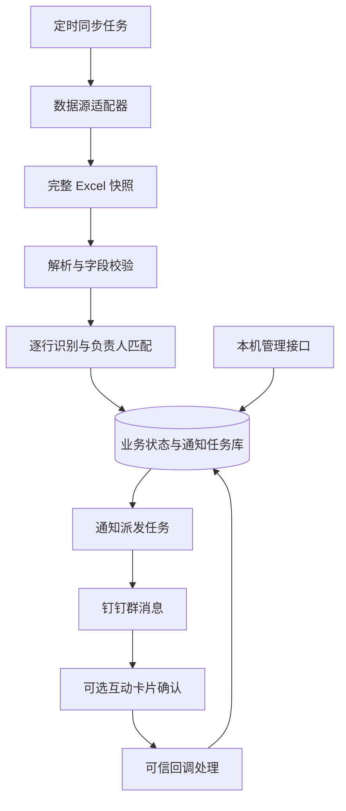

# Excel Bug 监控与钉钉通知系统技术设计文档

- 版本：V1.0（技术设计讨论稿）
- 日期：2026-10-19
- 需求依据：[需求文档.md](./需求文档.md)，以当前磁盘内容为准。
- 项目：`com.wf:monitor`
- 文档性质：结合现有代码提出的实施方案；本文中的模块、表和接口除明确说明外均为待开发设计。

## 1. 设计目标与范围

通过定时获取 Excel 快照，读取 Bug 行号、标题、问题描述和研发负责人，将新增且信息完整的记录发送到指定钉钉群并提醒对应研发人员。无法匹配负责人、信息未补齐或发送失败的记录保留，供后续批次继续处理。

首期实现单文件、单工作表、单群、多名负责人映射，支持失败重试、通知记录查询及人工补发。不引入消息队列、Redis 或微服务，采用单实例 Spring Boot 应用。

“负责人点击收到”是前次讨论中的扩展需求，尚未写入当前需求文档。本设计预留确认状态和互动卡片接入方案，默认关闭确认功能及周期提醒，不将其视为已经确定的首期交付内容。

## 2. 需求冲突与设计取舍

| 问题 | 当前需求表现 | 本文处理方式 |
| --- | --- | --- |
| 行号与唯一编号混用 | 指定以行号为依据，但 FR-03 和 AC-04 要求排序、插行后不重复 | 按行号模式设计首期，但明确只适用于追加写入、既有行不移动的表；如必须通过 AC-04，应改为稳定编号模式 |
| 重启恢复范围冲突 | 4.2 排除重启恢复，FR-07、非功能要求和 AC-05 又要求支持 | 推荐轻量持久化方案，避免丢失待处理记录；是否纳入首期需统一需求。若排除，则 AC-05 不能作为首期承诺 |
| 负责人必填规则不一致 | 字段表标记姓名非必填，但通知必须有接收人 | 允许先录入空负责人，通知前必须唯一匹配成功 |
| 历史通知与超时提醒混用 | FR-04 提及定时发送历史待处理 Bug，4.2 排除超时提醒 | 历史积压首次通知作为单独、默认关闭的任务；不循环通知已成功发送的记录 |
| 通知时效 | 目标为 2 分钟，当前代码每次执行完成后等待 5 分钟 | 调整调度并测量导出耗时；2 分钟仅在数据源可用且端到端耗时满足预算时成立 |

本稿不修改原需求文档。以上取舍是实施建议，不能消除原需求中互相矛盾的验收约束。

### 2.1 行号模式的明确约束

- 行号指用户在 Excel 中看到的物理行号，从 1 开始；Apache POI 下标从 0 开始，转换集中在解析层完成。
- 业务键为 `source_id + sheet_key + row_number`，不是单独的行号。
- 既有数据区域只允许原位补充字段，新增 Bug 追加到末尾；不得排序、插入中间行、删除或复用旧行。
- 行号字段中类似 `BUG-20261016-001` 的值属于业务编号，不是物理行号，两者须分别建模。
- 记录内容摘要用于发现异常变化，不能充当可靠的 Bug 身份；相同描述、描述修改都会影响摘要。
- 发现总行数回退、大量行位置异常等情况时，暂停该数据源的自动发送，等待核对。此检测不能发现所有排序或行复用问题。
- 若业务不能遵守上述约束，应增加稳定 `bug_id`，此时物理行号仅用于通知展示与定位。

## 3. 当前代码情况

| 文件 | 已有行为 | 需要调整 |
| --- | --- | --- |
| `MonitorApplication.java` | 启动 Spring Boot 并启用定时任务 | 保留应用入口 |
| `ExcelMonitorTask.java` | 使用 `fixedDelay=300000` 串行下载、检查并通知 | 配置化周期，区分快照同步和通知派发 |
| `newExcel.java` | 复用浏览器登录态，创建金山文档导出任务，下载并校验快照后替换文件 | 提取数据源适配器，配置化文档位置，处理登录失效和超时 |
| `check.java` | 用静态 `lastRows=416` 比较末行，缓存未填写负责人行，仅匹配指定姓名 | 去掉硬编码起始行和单人过滤，维护逐行状态，校验必需列 |
| `customRobotGroupMessage.java` | 合并行号并通过自定义机器人发送文本及提醒 | 返回结构化结果，区分业务失败与结果未知，按负责人分组 |

当前扫描阶段就更新 `lastRows`，但通知阶段没有可靠记录发送结果；如果发送失败，后续扫描可能跳过这些行。需要先保存待发送任务，再独立派发，不能用“已扫描到”代替“已发送”。

当前 POM 声明 Java 17，但编译插件显式配置 `source/target=11`；实施时应统一为 Java 17，并验证构建环境。POM 中的 Spring Boot、POI、Playwright 版本仅作为现状记录，不代表本稿已验证依赖可下载、兼容或构建通过。

当前快照写入 `src/main/resources/static/current.xlsx`。运行数据应迁移至应用外部的 `data/snapshots`，避免写入源码目录或成为静态资源。

## 4. 总体架构



建议使用现有 Spring Boot、Apache POI、Playwright；新增 Spring JDBC 和本地文件型数据库适配层。首期建议采用 H2 文件模式，仅由一个应用实例访问，具体驱动版本在实施时验证并锁定。若公司已有数据库标准，可替换为 MySQL，业务层接口保持一致。

持久化用于保存基线、待处理记录和通知结果；数据库方案为本稿建议，当前代码尚未接入。暂不引入分布式部署。

### 4.1 模块划分

| 模块 | 建议类名 | 职责 |
| --- | --- | --- |
| 数据源获取 | `SnapshotProvider`、`KdocsSnapshotProvider` | 下载或读取快照，返回版本和文件位置 |
| Excel 解析 | `ExcelBugParser` | 表头映射、行号转换、值格式化、必要字段校验 |
| 同步服务 | `BugSyncService` | 建立基线、记录变化、写入待处理状态 |
| 人员映射 | `OwnerResolver` | 根据表内姓名匹配唯一接收身份 |
| 通知编排 | `NotificationService` | 创建任务、分组、重试与补发 |
| 渠道发送 | `DingTalkGateway` | 签名、调用、响应分类、限流 |
| 调度 | `SnapshotSyncJob`、`NotificationDispatchJob` | 防止任务重叠，按计划触发处理 |
| 持久化 | `SourceRepository`、`BugRepository`、`NotificationRepository` | 事务及条件更新 |
| 可选确认 | `AcknowledgementService` | 回调校验、确认状态更新、取消提醒 |

## 5. 数据获取和 Excel 解析

### 5.1 数据源适配

现有数据源是金山文档在线表格导出的 Excel。保留现有浏览器登录态复用方式，将下载实现封装起来；不把当前使用的站点导出路径视为已承诺稳定的开放 API。

- 登录或导出失败时，不使用旧快照推断新增记录，不推进扫描状态。
- 登录态过期进入 `SOURCE_AUTH_REQUIRED` 状态，提示运行维护人员重新登录；不在每轮无限等待人工操作。
- 下载至临时文件，完成结构、目标工作表及表头校验后才发布新快照。
- 建议为快照分配唯一版本号。解析器只读取已经发布的不可变快照，避免边下载边读取。
- 浏览器任务串行执行，避免同一个用户配置目录被并发使用。
- 数据源访问参数、登录目录和运行目录均配置化；文档链接、Cookie 和下载签名链接不写入普通日志。
- 若后续改用本地或共享 Excel，实现 `LocalFileSnapshotProvider`，复制时校验文件是否在变化；读取不完整则延后重试。

### 5.2 解析规则

当前代码读取第 3 行作为表头，可作为初始配置，但不写死在业务逻辑中。按列名定位字段，不按固定列序号读取。

发送前必须具备：物理行号、标题和能唯一匹配的负责人。问题描述可空；若真实表格只有问题描述，应显式配置以描述摘要生成展示标题，不能静默假设存在标题列。

使用 POI `DataFormatter` 统一读取显示文本。负责人姓名只做首尾空白清理，不进行模糊匹配。无法识别的状态保留原值并记录异常；“已解决”“已关闭”映射为终态，阻止新增通知。

大文件是否使用事件读取方式应根据真实文件的内存占用决定。当前下载代码虽做结构校验，仍需单独验证目标工作表能够完整解析；校验通过不代表业务字段有效。

### 5.3 增量识别与首次基线

1. 首次成功获取并解析完整快照后，在同一事务中记录所有历史行及 `baseline_initialized=true`。
2. 历史行标记 `HISTORICAL_SKIPPED`；不创建默认新增通知。基线事务失败则整体回滚。
3. 后续扫描按业务键检查每一条有效行，更新待补全、待匹配记录，创建符合条件的新通知任务。
4. 空白行不作为已处理 Bug；之后填入内容时仍可识别。因此不能只依赖末行游标。
5. 每轮更新待发送记录的最新负责人及关闭状态；已发送记录的普通内容修改不创建新通知。
6. 当前快照中缺失的待发送行进入 `SOURCE_MISSING`，暂停发送，不能按旧内容继续通知。

历史积压补发任务默认关闭。启用后只选取历史跳过、未关闭、信息完整且未成功通知的记录，转为一次性 `BACKLOG_INITIAL` 任务；后续批次不会反复发送同一历史记录。

## 6. 数据模型

以下为逻辑表结构，具体 DDL 在实现时按数据库生成；时间统一持久化为 UTC，日志和查询展示使用 `Asia/Shanghai`。

### 6.1 `monitor_source`：数据源状态

| 字段 | 说明 |
| --- | --- |
| `id` | 数据源标识，主键 |
| `sheet_key` | 配置中的工作表标识 |
| `identity_mode` | `ROW_NUMBER` 或未来的 `STABLE_ID` |
| `baseline_initialized` | 是否完成基线建立 |
| `last_snapshot_id`、`last_success_at` | 最近一次成功提交的快照及时间 |
| `source_status`、`last_error_code` | 正常、待登录、异常暂停等状态 |

### 6.2 `bug_record`：行记录

| 字段 | 说明 |
| --- | --- |
| `id` | 内部生成的记录主键 |
| `source_id`、`sheet_key`、`row_number` | 行号模式业务键，建立联合唯一约束 |
| `external_bug_id` | 稳定编号模式预留字段 |
| `title`、`description`、`business_status` | 当前业务字段 |
| `owner_name`、`recipient_key` | 原始姓名及解析后的接收身份 |
| `processing_status` | 待补全、待匹配、可通知、历史跳过、已关闭、来源缺失 |
| `snapshot_id`、`content_hash`、`version` | 快照关联、变更辅助检测及并发版本 |
| `first_seen_at`、`updated_at` | 发现时间与更新时间 |

稳定编号模式启用时另建 `(source_id, sheet_key, external_bug_id)` 唯一约束，以稳定编号作为身份，行号允许变化；不能只在行号模式中添加一个未参与识别的编号字段。

### 6.3 `notification_task`：通知任务

| 字段 | 说明 |
| --- | --- |
| `id` | 通知任务主键 |
| `bug_record_id` | 关联 Bug |
| `notification_type` | `INITIAL`、`BACKLOG_INITIAL`、`MANUAL_RESEND`，可选 `REMINDER` |
| `dedup_key` | 唯一索引，初次通知统一使用 `first:{bugRecordId}` |
| `recipient_key`、`group_key` | 本次发送对象与群配置标识 |
| `send_status` | 待发送、发送中、成功、待重试、失败、未知、取消 |
| `attempt_count`、`next_attempt_at` | 尝试次数及下次可发送时间 |
| `batch_id` | 所属消息批次，可空 |
| `provider_message_id` | 平台返回标识，可空，不能假定所有渠道均提供 |
| `ack_status`、`ack_by`、`ack_at` | 可选确认状态、确认人和时间 |
| `lease_until`、`version` | 任务领取期限和并发控制 |
| `last_error_code`、`created_at`、`sent_at` | 错误与时间信息 |

`INITIAL` 和 `BACKLOG_INITIAL` 共用首次通知去重键，避免两类任务各发送一次。人工补发使用独立请求幂等键，重复提交同一个请求不能创建多条任务。

### 6.4 `notification_batch`、`notification_attempt` 与人员映射

- `notification_batch` 保存一次真实消息的任务集合、接收人、内容快照及发送状态，必须在网络调用前落库。
- `notification_attempt` 保存批次每次调用的开始时间、结束时间、结果分类和脱敏错误；一个批次包含多条 Bug 时，记录与各任务的对应关系。
- `owner_mapping` 保存精确姓名、接收身份、启用状态和渠道信息。自定义机器人提醒身份与应用卡片用户身份应分别配置，不能将手机号直接当作应用用户 ID。
- 可选 `callback_event` 保存回调事件标识及处理结果，用于重复事件去重；若渠道无稳定事件标识，使用通知状态的原子更新保证业务幂等。
- 人工操作保存操作者、原因、请求幂等键与时间，便于追踪。

## 7. 通知发送、批处理与可靠性

### 7.1 状态机

```text
PENDING → SENDING → SENT
                  → RETRY_WAIT → SENDING
                  → FAILED
                  → UNKNOWN
PENDING / RETRY_WAIT → CANCELLED（已关闭或任务失效）
```

负责人未匹配与信息不完整属于 Bug 的处理状态，不消耗网络重试次数。“下一批处理”指再次检查这些记录或派发到期任务，不是每批重新通知所有 Bug。

### 7.2 派发步骤

1. 获取当前数据源状态；来源异常、快照过旧或必要数据缺失时暂停派发，待同步成功后继续。
2. 选择到期的 `PENDING/RETRY_WAIT` 任务，通过条件更新领取，防止并发重复领取。
3. 再次核对最新已发布快照内的负责人、记录版本与关闭状态；发送前负责人变化时更新接收人并重新分组。
4. 按接收人和群分组；按渠道长度限制拆分，生成并持久化批次及其任务关系。
5. 事务提交后调用钉钉；不在数据库事务内等待外部网络。
6. 按明确响应将批次及所含任务更新为成功、待重试、失败或未知；在同一事务提交这些结果。

首期文本消息可将同一负责人的多条 Bug 合并，内容至少包含每条 Bug 的行号、标题、问题描述摘要。负责人提醒仅指向该批次接收人。开启互动卡片确认时优先每条 Bug 一张卡片，避免“收到”究竟确认哪几条记录产生歧义。

### 7.3 结果分类

| 结果 | 处理 |
| --- | --- |
| HTTP 成功且平台业务结果明确成功 | 标记 `SENT`，后续普通扫描不再发送 |
| 平台明确拒绝且属于可恢复错误 | 按配置进入 `RETRY_WAIT` |
| 配置错误、无权限等不可恢复错误 | 标记 `FAILED`，修复后人工重试 |
| 请求超时、连接中断，不能确定平台是否接收 | 标记 `UNKNOWN`，不盲目自动重发 |
| 进程在网络调用中退出，任务领取期限已过 | 转 `UNKNOWN`，查询或人工核对；不能直接恢复为待发送 |

仅 HTTP 200 不足以判定成功。业务成功码和错误分类由渠道适配器依据实际接口文档实现。

建议首次尝试后最多重试 3 次，等待时间 60、120、300 秒；即最多 4 次调用。网络状态未知不计入可自动重试的明确失败。限流参数配置化，以实际机器人接口限额为准。

本地事务无法与钉钉发送构成原子事务：平台已接收、应用尚未落库时可能崩溃。唯一索引只能防止本地重复任务，不能单独保证跨系统严格只发送一次。若所选渠道提供可验证的幂等键或查询能力，应接入；否则保留 `UNKNOWN` 待核对，在防重与自动补发之间明确取舍。

## 8. 钉钉渠道与“确认收到”扩展

### 8.1 首期文本群机器人

延续当前群自定义机器人发送方式，将 Webhook 和签名密钥外置。安全配置以[钉钉自定义机器人官方文档](https://open.dingtalk.com/document/orgapp/custom-robot-access)为准。

`DingTalkGateway.send(batch)` 返回 `SUCCESS`、`RETRYABLE_FAILURE`、`PERMANENT_FAILURE` 或 `UNKNOWN`，同时返回允许保存的平台标识及脱敏错误。不得继续使用只打印响应、不向调用者返回结果的 `void` 方法。

截图中的系统快捷“收到”不能直接当作业务确认。当前代码没有接收该操作事件的能力，也没有证据证明现有群机器人接口能够提供这种回调。因此文本版以发送记录防止重复扫描通知，不依赖用户点击。

### 8.2 可选互动卡片

如果确定需要确认功能，接入应用侧互动卡片，在卡片中提供自定义【确认收到】按钮。官方教程支持通过按钮回传请求处理交互，Stream 协议支持卡片互动回调；这与现有文本 Webhook 是不同的接入配置。[卡片回调教程](https://opensource.dingtalk.com/developerpedia/docs/explore/tutorials/stream/bot/go/card-callback/)、[Stream 协议](https://opensource.dingtalk.com/developerpedia/docs/learn/stream/protocol/)

建议优先评估 Stream 接收回调，其使用应用身份建立出站连接，无需为回调开放公网入口。卡片发送仍通过对应服务端 API 完成。[Stream 官方概述](https://opensource.dingtalk.com/developerpedia/docs/learn/stream/overview/)

接入前必须验证企业应用权限、群投放权限、卡片模板、接收身份映射及 Java SDK。当前 POM 中的机器人 SDK 不代表已经具备卡片和 Stream 功能，SDK 选择与版本在联调时确认。

### 8.3 确认处理与停止提醒

1. 回传业务参数包含内部 `notification_id`，不信任按钮参数自带的操作者姓名或身份。
2. 使用经过渠道认证的事件操作人身份，校验其与通知接收人一致；校验卡片实例确实属于该通知。
3. 在数据库事务中执行“未确认 → 已确认”条件更新，同时保存确认人和时间；重复点击或重复回调不重复执行副作用。
4. 取消尚未派发的提醒任务，并清空下一次提醒时间。
5. 提交后更新卡片显示为“已确认”；卡片更新失败只重试展示更新，不能回滚业务确认。
6. 回调处理需快速落库并按平台协议回复；数据库失败时不能假报业务确认成功。

若回调早于发送结果落库到达，应允许基于已登记的卡片实例关联通知并保存确认，后续发送结果更新不能覆盖确认状态。

只有未来启用未确认提醒时才调度 `REMINDER`。发送前需再次检查确认状态，与确认操作使用同一任务状态条件或锁进行同步。已经提交给钉钉的在途提醒可能在确认后到达，不承诺撤回。

已确认不等于 Bug 已解决，不自动改写 Excel。已发送后负责人更换时，旧通知仍表示原接收人的接收确认；若未来需要转派通知，应建立新的分派版本及独立确认链路。

## 9. 内部管理接口建议

首期无需管理页面，提供受认证保护的本机管理接口；接口默认只监听回环地址，远程访问另行配置认证及网络限制。以下为本系统拟建接口，不是钉钉 API。

| 方法与路径 | 用途 |
| --- | --- |
| `GET /internal/monitor/status` | 最近成功同步时间、数据源状态、待发送和失败数量 |
| `GET /internal/notifications` | 按行号、接收人、状态分页查询 |
| `POST /internal/notifications/{id}/retry` | 对明确失败任务重试，保留原首次通知身份 |
| `POST /internal/notifications/{id}/resend` | 主动补发，要求原因及请求幂等键 |
| `POST /internal/monitor/scan` | 触发一次扫描；已有扫描运行时不并发启动 |
| `POST /internal/mappings/reload` | 校验并加载人员映射，失败则保留旧映射 |

`UNKNOWN` 任务需先核对平台结果，再标记已发送或明确选择补发；不能通过普通自动重试接口绕过。

## 10. 配置设计

以下为拟定配置示例，当前代码尚未实现这些配置绑定。示例中的环境变量不得填入真实值并提交到仓库。

```yaml
monitor:
  source-id: bug-sheet-01
  source-type: kdocs
  document-url: ${MONITOR_DOCUMENT_URL}
  sheet-name: 全生命周期管理表
  header-row: 3
  identity-mode: ROW_NUMBER
  sync-interval: 60s
  dispatch-interval: 10s
  max-snapshot-age: 90s
  data-dir: ./data
  historical-notification-enabled: false
  fields:
    title: Bug标题
    description: 问题描述
    owner: 研发负责人
    status: 当前状态
  retry:
    max-retries: 3
    delays: [60s, 120s, 300s]
  acknowledgement-enabled: false
  reminder-enabled: false
dingtalk:
  channel: custom-robot
  webhook: ${DINGTALK_WEBHOOK}
  signing-secret: ${DINGTALK_SIGNING_SECRET}
```

列名以实际表格为准。人员映射独立存储在受控配置或数据库中，禁止在代码中写死单个人员。映射缺失的记录每轮继续检查；负责人已成功通知后，映射更新不自动触发重复通知。

## 11. 调度、性能与部署

### 11.1 时效预算

端到端延迟约为：`等待下次同步 + 导出下载解析 + 等待派发 + 渠道调用`。例如 60 秒等待、40 秒导出解析、10 秒派发等待、10 秒发送共 120 秒，这是预算，不是已测结果。

同步建议按固定频率触发但禁止重叠；上一轮未完成时跳过并记录延迟。若沿用 `fixedDelay`，两次开始间隔还包含上一轮执行时间，不能将 60 秒延迟直接等同于每分钟获取一次最新数据。

现有在线导出包含登录等待及长时间任务轮询，不能保证两分钟。需用实际文件测量 P95 导出及解析耗时；若持续超过预算，应协商时效、采用更轻的授权数据接口或改用可直接访问的文件源。

### 11.2 部署与恢复

- 单台稳定运行设备部署 Java 17 应用，运行账号能访问目标文档和钉钉。
- 首次登录在交互环境完成；当前浏览器流程依赖可见窗口，不能未经验证就作为无桌面服务部署。
- 外置 `config/`、`data/snapshots/`、`data/db/` 和 `logs/`，使用独立且固定的运行目录。
- 应用启动先检查配置、数据库、工作表和人员映射，再启动同步及派发。
- 若采纳持久化方案，数据库存在时从原状态继续；数据库丢失时不得静默重建基线，应进入恢复模式等待明确处理。
- 本地数据库仅单实例打开；使用数据库支持的备份机制或停机备份，不直接复制正在写入的数据库文件。
- 关闭时停止领取新任务，等待在途操作；来不及完成的发送在恢复时进入未知状态核对。

### 11.3 可观测性与数据保护

日志使用 `source_id`、`snapshot_id`、`notification_id`、`batch_id` 串联，不打印签名、Webhook、登录 Cookie、完整下载链接及无必要的 Bug 内容。移除当前发送代码中签名输出，并将凭证移出源码。

监控最近成功同步时间、同步耗时、待补全数、待匹配数、待发送数、失败数、未知结果数。连续异常只在首次发生及恢复时输出明确事件，重复异常按时间窗口汇总；钉钉本身不可用时仍须保留本地日志。

## 12. 验证与验收计划

| 测试场景 | 预期结果 | 对应需求 |
| --- | --- | --- |
| 首次读取已有表格 | 事务建立基线，无历史通知 | AC-06 |
| 末尾追加一条完整 Bug | 生成一个首次通知，正确提醒负责人 | AC-01 |
| 空白行后续填入、负责人后续补全 | 下一轮处理，不因末行游标跳过 | AC-02 |
| 重复扫描及并发触发派发 | 同一首次通知唯一，任务只被领取一次 | AC-03 |
| 姓名重复或未配置 | 待匹配，不向错误人员发送 | AC-07 |
| 导出失败或工作表异常 | 不推进状态，不按旧快照发送 | AC-08 |
| 明确可恢复发送失败 | 到期后重试，最多 4 次尝试 | AC-09 |
| 平台已接收但客户端超时 | 进入未知，不自动重复发送 | FR-08 |
| 发送成功后进程重启 | 不重复通知；须采纳持久化范围 | AC-05 |
| 发送前负责人变更或关闭 | 重分组或取消任务 | AC-12 |
| 人工补发请求重复提交 | 同一请求只生成一次补发 | AC-11 |
| 同一批次包含多条 Bug | 成员结果与批次结果一致，失败不丢行 | FR-07/08 |
| 行排序、插行和行复用 | 行号模式不承诺正确；稳定编号模式才按身份去重 | AC-04/10 范围待统一 |
| 可选卡片重复点击、他人点击 | 合法确认一次，拒绝非负责人确认 | 扩展需求 |
| 可选确认与提醒并发 | 未派发提醒取消，在途消息边界有记录 | 扩展需求 |

实现时分别对解析、状态流转和发送结果分类做单元测试；用临时数据库验证唯一约束、事务回滚及重启恢复；用可控模拟渠道验证超时和崩溃窗口。最终在测试群进行端到端联调，记录真实时效。本文编写阶段未执行构建、发送真实消息或验证上线环境。

## 13. 实施顺序与交付物

1. 统一行号/稳定编号及重启恢复的需求边界；确认实际表头、人员映射和目标群。
2. 配置化现有下载与解析代码，统一 Java 编译版本，将运行数据移出静态资源目录。
3. 建立逐行记录、基线和通知任务模型；优先修复“扫描推进后发送失败导致漏发”的问题。
4. 封装钉钉发送结果，完成按负责人分组、持久化批次、失败重试和未知状态处理。
5. 补齐查询、人工补发、运行日志及实际场景验收，完成测试群联调。
6. 在业务确定后单独接入互动卡片确认；周期提醒仍需明确周期、上限及停止条件后才启用。

交付物包括：应用代码及配置模板、数据库初始化脚本、人员映射模板、部署和恢复说明、测试记录。当前交付为本技术设计文档，未修改应用行为。
